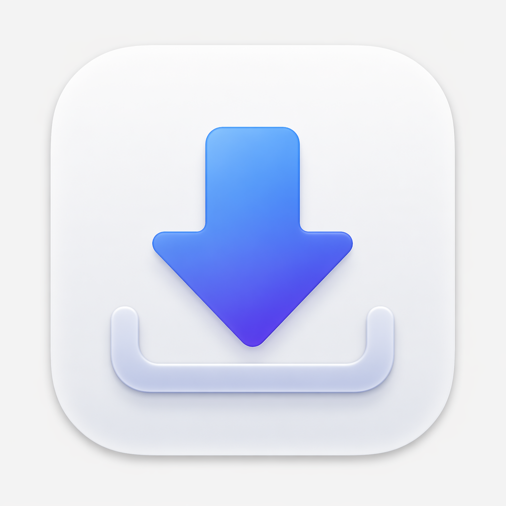
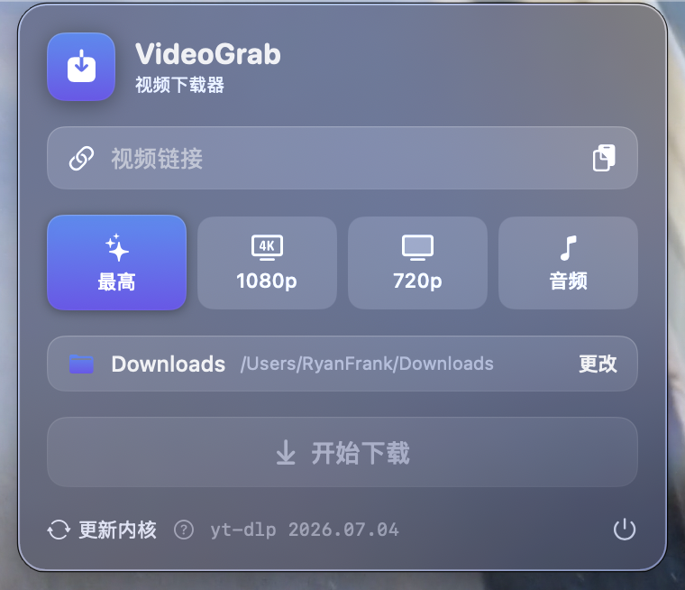

<p align="center">
  
</p>

<h1 align="center">VideoGrab</h1>

<p align="center">
  A lightweight macOS menu bar app: <strong>copy a video link, open the panel, save it locally</strong>.
</p>

<p align="center">
  <a href="README.md">中文</a> ·
  <strong>English</strong>
</p>

<p align="center">
  
  
  
</p>

<p align="center">
  
</p>

It lives in your menu bar. Copy a video URL, open the panel (it auto-fills), pick a quality, and save locally. Ships with yt-dlp + ffmpeg and handles per-site network routing automatically.

- 🪶 **Lightweight** — native Swift + SwiftUI, no third-party dependencies
- 🔗 **Common video sites** — built-in engine, plus dedicated parsers where needed. WeChat Channels is recognized but not downloadable
- 🌐 **Smart routing** — CN sites connect directly; overseas sites auto-detect local Clash proxy ports
- 🍪 **Login cookies** — sites that need a login read Chrome cookies automatically
- 📋 **Clipboard prefill** — detects video URLs from clipboard when the panel opens
- 📊 **Progress & notify** — live progress bar; system notification on completion; click to open save folder

> 📦 **Download**: grab the prebuilt `VideoGrab.zip` from [Releases](https://github.com/aright8-sys/VideoGrab/releases/latest), or build it yourself (see below).

## 🆕 Changelog

### v2.2 — Vimeo downloads & hardening

- 🎬 **Vimeo downloads** — the usual extractor is blocked; VideoGrab uses local Chrome to pass the challenge and reassembles DASH segments (Google Chrome must be installed).
- ⚡ **Faster, leaner Vimeo** — segments fetch four at a time and stream to disk (long videos no longer sit entirely in memory); the title is taken as soon as it's ready, and Cloudflare challenge titles ("Just a moment…") never become the filename.
- 📌 **Pinterest** — native pins still go through yt-dlp; embedded Vimeo pins are handed to the Vimeo parser.
- 💬 **WeChat Channels** — recognized, then told clearly that download isn't supported (no public download API).
- 🛡️ **Proxy detection false positives fixed** — after finding an open local port, VideoGrab sends one real request through it to confirm it actually is a proxy; random apps squatting on 8080/8888 are no longer mistaken for Clash (which used to break all foreign-site downloads).
- 🔒 **Stricter site & URL matching** — hosts now match by domain suffix, so spoofed domains like `bilibili.com.evil.com` are no longer treated as Bilibili and forced direct; clipboard links only accept legal URL characters — links glued to Chinese text (no space) previously swallowed the entire sentence into the URL and failed, now they're cut at the first illegal character.
- 🔄 **ffmpeg follows app updates** — the writable copy carries a version fingerprint and is refreshed automatically when a newer build ships, instead of staying frozen at the first-installed version forever; yt-dlp still self-updates via "Update core" and is never overwritten.
- 🧵 **Two rare race conditions fixed** — the notification's target folder is lock-guarded against concurrent read/write, and stale callbacks from a cancelled download are invalidated by generation, so instantly starting a new download can't have its progress polluted by the dying one.
- 📦 **Reproducible builds** — `build-app.sh` pins yt-dlp / ffmpeg versions and verifies sha256 digests; truncated or tampered kernels abort the build, and mismatched existing ones are re-fetched automatically.
- ✅ **Automated tests added** — 13 tests pin down every site parser (domain matching / URL trimming / progress parsing / Xinpianchang quality picking / WeChat short IDs / Pinterest→Vimeo detection / Vimeo manifest parsing); run `swift test` once to know if a change broke something.

### v2.1 — Fix Xinpianchang downloads

- 🔧 **Fixed broken Xinpianchang downloads**: article pages now sit behind a Wangsu JS anti-bot challenge, so yt-dlp's direct page fetch gets `403 / 406`. VideoGrab now resolves the direct link via the mobile share API (which bypasses the challenge) and downloads it with a native downloader — the CDN requires a `Range` header and the link is an IP-bound pre-signed URL that can't be routed through yt-dlp.
- 🧾 **Scrollable error card**: long errors are no longer truncated or hidden behind the footer; fully selectable and copyable.

### v2.0 — Redesigned UI + Xiaohongshu support

A major release with a fully reworked interface and experience:

- 🌹 **Xiaohongshu (RED) downloads** — supports `xiaohongshu.com` / `xhslink.com` short links; direct CN connection + automatic Chrome login cookies.
- 🎨 **Completely redesigned UI** — card-based layout on a frosted-glass background, a blue→indigo brand gradient echoing the app icon, and subtle top highlight strokes on every card.
- 🖼️ **New app icon** — reshaped to Apple's latest spec (transparent margins, standard squircle corners) instead of a hard square.
- 🎚️ **Icon-based quality picker** — Best / 1080p / 720p / Audio as four clear pill buttons with a highlighted selection.
- 📊 **Prettier download flow** — custom gradient progress bar + large animated percentage, smooth state transitions; success / failure shown as green / orange cards with one-click "open in Finder".
- ❓ **"Update core" help** — a clickable question mark next to it pops up an explanation of what the yt-dlp "core" is.
- ✨ **Enhanced input field** — inline clear button, link icon, one-tap paste.

## ⚠️ Disclaimer

> This is a personal project, **not affiliated with, authorized, or endorsed by Bilibili,
> Xinpianchang, YouTube, or Google**.
> It downloads videos via [yt-dlp](https://github.com/yt-dlp/yt-dlp), which may violate each
> platform's Terms of Service; downloading copyrighted content may carry legal risk.
>
> **Where your data goes**:
> - **Downloads**: yt-dlp runs locally; files are saved to a folder you choose.
> - **Login cookies**: read from your local Chrome browser only when a site needs a login session;
>   never uploaded or sent elsewhere.
> - **Core updates**: "Update core" fetches the latest yt-dlp from GitHub (overseas; uses local proxy).
>
> For personal, educational use only — **use at your own risk and respect platform ToS and copyright law**.

## How it works

### Network routing

Different sites need opposite network paths; the app picks automatically by hostname:

| Kind | Route |
| --- | --- |
| CN sites | Direct |
| Login-gated sites | Chrome cookies |
| Overseas sites | Local Clash proxy (7897/7890, etc.) |
| Vimeo | Local Chrome (yt-dlp extractor is broken) |
| WeChat Channels | Title lookup only; no download |

On launch, inherited `*_proxy` environment variables are cleared so GUI and terminal behave consistently.

### Download core

`build-app.sh` downloads yt-dlp and ffmpeg into `Resources/bin/` and bundles them into `.app`.
On first run they are copied to `~/Library/Application Support/VideoGrab/bin/` (writable, self-updatable).

### What is "Update core"?

The "Update core" button at the bottom of the panel upgrades the **yt-dlp** download engine. VideoGrab itself is only the GUI shell — yt-dlp (with ffmpeg) does the actual page parsing, stream fetching, and muxing, hence the "core". Video sites change their pages and anti-bot measures often, which can break an older yt-dlp. **When a link suddenly fails to download, click "Update core" first**: it runs `yt-dlp -U`, self-updates the writable copy in Application Support (no reinstall needed), uses your local proxy or a direct connection automatically, and shows the new version when done.

## Build & run

Requires macOS 14+ and a Swift toolchain (Xcode or the Command Line Tools is enough — you don't need to
open Xcode).

```bash
./build-app.sh            # compile and package into VideoGrab.app
open VideoGrab.app        # run
cp -r VideoGrab.app /Applications/   # install (optional)
```

Development:

```bash
swift build               # compile only
swift test                # parser tests
```

## Usage

1. After launching, click the ⬇️ icon in the menu bar.
2. Copy a video URL; open the panel (clipboard URL is auto-filled).
3. Pick a quality and click "Download".
4. **Login-gated content**: if a "Chrome Safe Storage" Keychain prompt appears, click
   "Always Allow" and enter your password (once only). Sign in to the site in Chrome first.
5. **YouTube and other overseas sites**: start your local Clash (or similar) proxy first.
6. **Vimeo**: Google Chrome must be installed.
7. **WeChat Channels**: download is not supported.

## Project layout

```
Sources/VideoGrab/
  VideoGrabApp.swift       App entry + MenuBarExtra
  AppState.swift           State, clipboard prefill, download scheduling
  Downloader.swift         yt-dlp wrapper, proxy routing, progress parsing
  Sites.swift              Site matching and URL trimming
  PopoverView.swift        Popover panel UI
  Notify.swift             Download-complete notifications
  VimeoDownloader.swift    Vimeo (Chrome + segment reassembly)
  ChromeCDP.swift          Headless Chrome DevTools Protocol
  PinterestResolver.swift  Pinterest → Vimeo detection
  WechatChannels.swift     Channels lookup (no download)
  Xinpianchang.swift       Xinpianchang direct-link parser
build-app.sh               Packaging script (fetch cores + write LSUIElement)
```

## License

[MIT](LICENSE)
