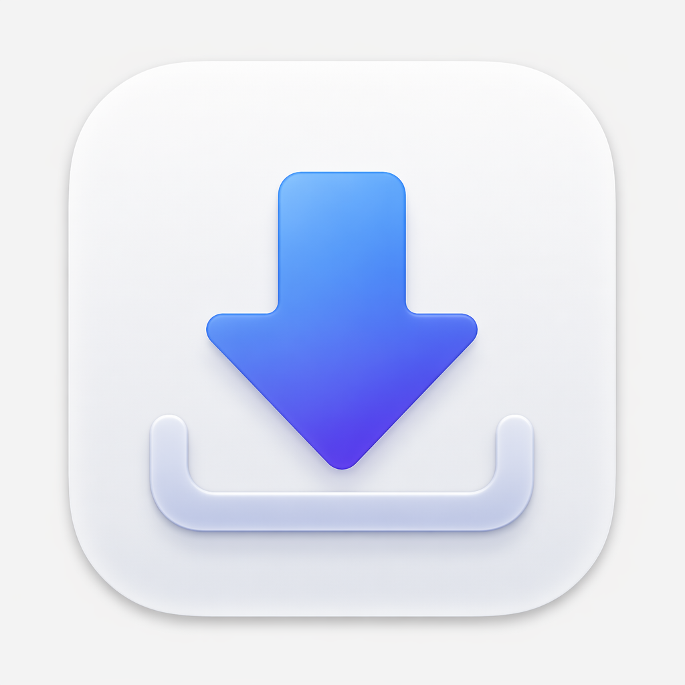
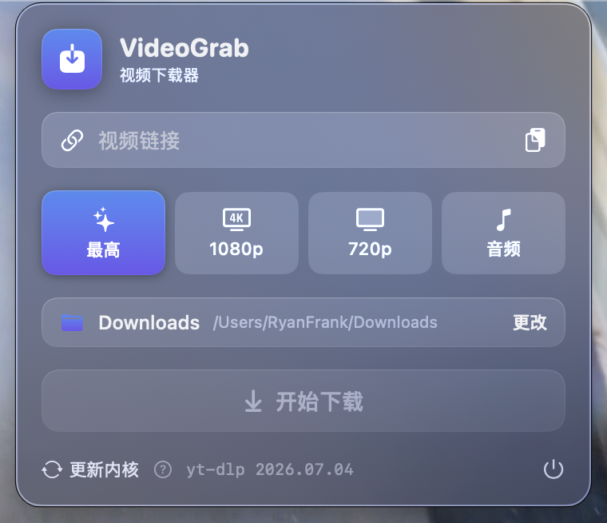

<p align="center">
  
</p>

<h1 align="center">VideoGrab</h1>

<p align="center">
  一个轻量的 macOS 菜单栏小工具：<strong>复制视频链接，打开即可下载到本地</strong>。
</p>

<p align="center">
  <strong>中文</strong> ·
  <a href="README.en.md">English</a>
</p>

<p align="center">
  
  
  
</p>

<p align="center">
  
</p>

它常驻菜单栏。复制视频链接，打开面板（会自动填入），选择画质，即可下载到本地。内置 yt-dlp + ffmpeg，自动处理国内/国外站点的网络分流。

- 🪶 **轻巧**：原生 Swift + SwiftUI，无第三方依赖
- 🔗 **常见视频网站**：内置下载引擎；个别站点走专用解析。视频号能识别，但不支持下载
- 🌐 **智能分流**：国内站强制直连，国外站自动探测本地 Clash 代理端口
- 🍪 **登录态**：需要登录才能稳定下载的站点，自动读取本机 Chrome Cookie
- 📋 **剪贴板自动收集**：常驻监听剪贴板——浏览器里每复制一条链接就自动加入下载列表（面板内可关闭）；也可从文本里整段复制多条，自动去重
- 📚 **批量队列下载**：多条链接排队依次下载，进度显示「第 n/N 个」；单个失败不中断队列，全程只在结束时通知一次
- 📊 **进度与通知**：实时进度条，完成后系统通知，点击打开保存目录
- 🔍 **检查更新**：一键查询 GitHub Releases；有新版可在面板里直接安装并重启，也可打开网页下载

> 📦 **直接下载**：前往 [Releases](https://github.com/aright8-sys/VideoGrab/releases/latest) 下载打包好的 `VideoGrab.zip`，或按下方说明自行构建。

## 🆕 更新日志

### v2.4 — 应用内一键更新

- ⬇️ **一键安装新版本**：点「检查更新」后，有新版可直接在面板里下载、校验并替换 App，完成后自动重启；也可仍走「网页下载」。
- 🔒 **更新包校验**：只接受本仓库、带具体 tag 的 `VideoGrab.zip`，并用 GitHub 提供的 sha256 digest 核对；Bundle ID 必须匹配，版本必须严格更高。下载可取消，安装失败会回滚。
- 📋 **剪贴板收集可关**：链接列表工具条可关闭自动收集，设置会记住；下载或更新进行中不会再往列表里塞链接。

### v2.3 — 批量队列下载与剪贴板自动收集

- 📚 **批量队列下载**：一次粘贴多条链接，排队依次下载。进度卡片显示「第 n/N 个 · 下载中」，某一条失败不中断队列；全程只在结束时发一次系统通知（「队列下载成功」或「成功 X 个，失败 Y 个」），结果卡片里的失败明细可选中复制。
- 📋 **剪贴板自动收集**：App 常驻后台监听剪贴板——在浏览器里每复制一条链接，它会自动进入下载列表，无需打开面板、无需手动粘贴；也支持在文本文档里整段复制多条链接（一行一条或夹在文字里都行）。同一条链接重复复制只算一次。
- 🔢 **链接列表化输入**：每条链接独立一行，带序号徽章与细分隔线，底部实时统计条数；行内可直接编辑，整段粘贴自动按行拆分。链接多到超过屏幕可用高度时，列表自动折叠为滚动区（高度随屏幕自适应），底部统计条始终可见。
- 🔍 **检查更新**：面板右下角新增「检查更新」，一键查询 GitHub Releases 最新版本；有新版弹出横幅、点击直达下载页，已是最新则短暂提示。
- 🧹 **单链接行为不变**：只复制一条时依旧走原流程，完成时照常发单条「下载完成」通知。

### v2.2 — Vimeo 下载与稳定性加固

- 🎬 **新增 Vimeo 下载**：普通下载路已被挡住，改为用本机 Chrome 过验证、再把分片拼成文件（需要装着 Google Chrome）。
- ⚡ **Vimeo 更快、更省内存**：分片 4 路并发、边下边写硬盘——长视频不再把整部片子先塞进内存；标题就绪即取，不再空等，也不会把 Cloudflare 挑战页的「Just a moment…」当成文件名。
- 📌 **Pinterest**：原生视频照常下；里面嵌的 Vimeo 会自动转过去。
- 💬 **微信视频号**：认得出是哪条，并明确告诉你下不了（没有公开下载接口）。
- 🛡️ **代理识别防误判**：探测到本地代理端口后，先代发一次真实请求确认它真是代理再使用——8080/8888 上恰好跑着的其它本地程序不会再被误当成 Clash，导致国外站全部失败。
- 🔒 **网站与链接识别更严格**：站点域名改为后缀精确匹配，「bilibili.com.evil.com」这类伪装域名不再被误判成 B 站而强制直连；剪贴板链接只认合法 URL 字符——聊天软件里「链接后紧跟中文、无空格」曾把整句话吞进网址导致失败，现在从第一个非法字符处截断。
- 🔄 **ffmpeg 跟随 App 更新**：用户目录里的 ffmpeg 加了版本指纹，升级 App 后自动换新，不再永远停在首装版本；yt-dlp 依旧走「更新内核」自我升级、绝不被覆盖。
- 🧵 **修复两处小概率状态错乱**：通知跳转目录加锁防并发读写；取消下载后旧任务的迟到回调一律作废——手快立刻开新下载，进度和结果也不会互相污染。
- 📦 **构建可复现**：`build-app.sh` 锁定 yt-dlp / ffmpeg 版本号并以 sha256 指纹校验，文件不完整或被篡改时构建直接终止，已有内核指纹不符会自动重新拉取正确版本。
- ✅ **新增自动化测试**：13 条测试钉住各站点解析逻辑（域名匹配 / 链接剪裁 / 进度解析 / 新片场画质选择 / 微信短链 / Pinterest→Vimeo 判定 / Vimeo 清单解析），改完代码跑一次 `swift test` 即知有没有改坏。

### v2.1 — 修复新片场下载

- 🔧 **修复新片场无法下载**：新片场文章页新增了网宿（Wangsu）JS 反爬挑战，yt-dlp 直接抓页面会被 `403 / 406` 挡住。改为走移动端分享页接口解析出直链（绕开挑战），再用原生下载器按字节原样请求（该 CDN 需要 `Range` 头，且直链是绑定出口 IP 的预签名 URL，不能过 yt-dlp）。
- 🧾 **报错卡片可滚动**：长报错不再被截断、不再遮住底部按钮，可完整选中复制。

### v2.0 — 全新界面 + 小红书支持

这是一次大版本更新，界面与体验全面重做：

- 🌹 **新增小红书下载**：支持 `xiaohongshu.com` / `xhslink.com` 短链，国内直连 + 自动读取 Chrome 登录态。
- 🎨 **界面彻底重做**：卡片化布局 + 毛玻璃背景，呼应 App 图标的蓝→靛蓝品牌渐变，所有卡片加入顶部高光描边，更有质感。
- 🖼️ **全新 App 图标**：重排为符合苹果最新规范的圆角图标（透明留白边距、标准超椭圆圆角），不再是生硬的方块。
- 🎚️ **图标化画质选择器**：最高 / 1080p / 720p / 音频，四个药丸按钮一目了然，选中项高亮。
- 📊 **更美观的下载过程**：自定义渐变进度条 + 大号百分比（数字滚动动画），状态切换带平滑过渡；完成 / 失败以绿、橙色卡片呈现，可一键在访达打开。
- ❓ **「更新内核」说明**：旁边新增可点击的问号，点一下弹出说明，解释「内核」即下载引擎 yt-dlp。
- ✨ **输入框增强**：内联清空按钮、链接图标、一键粘贴。

## ⚠️ 免责声明

> 本项目为个人作品，**与 Bilibili、新片场、YouTube / Google 均无关，未获其授权或背书**。
> 它通过 [yt-dlp](https://github.com/yt-dlp/yt-dlp) 下载视频，可能违反各平台服务条款；
> 下载受版权保护的内容可能涉及法律风险。
>
> **数据流向**：
> - **下载过程**：在本机调用 yt-dlp，视频文件保存到你指定的本地目录。
> - **登录 Cookie**：仅在下载需要登录态的站点时，从本机 Chrome 浏览器读取登录 Cookie，不上传、不外发。
> - **内核更新**：「更新内核」会从 GitHub 拉取最新 yt-dlp（国外站点，走本地代理）。
> - **检查更新**：向 GitHub API 查询最新版本号；若选择一键安装，会从 GitHub 下载 zip 并在本机替换 App。仅读取、不上传任何数据。
>
> 仅供个人学习与自用，**请自行评估并承担使用风险，遵守平台条款与版权法**。

## 工作原理

### 网络分流

不同站点对代理的需求相反，App 会按目标域名自动选择：

| 类型 | 走法 |
| --- | --- |
| 国内站 | 直连 |
| 需登录的站 | 自动读取 Chrome Cookie |
| 国外站 | 走本地 Clash 代理（7897/7890 等） |
| Vimeo | 本机 Chrome 解析（yt-dlp 提取器已坏） |
| 视频号 | 识别标题，不提供下载 |

App 启动时会清理继承来的 `*_proxy` 环境变量，避免 GUI 与终端行为不一致。

### 下载内核

首次构建时 `build-app.sh` 会下载 yt-dlp 和 ffmpeg 到 `Resources/bin/`，打包进 `.app`。
首次运行时复制到 `~/Library/Application Support/VideoGrab/bin/`（可写、可自更新）。

### 「更新内核」是什么？

面板底部的「更新内核」指的就是升级下载引擎 **yt-dlp**。VideoGrab 本身只是图形外壳，真正解析网页、抓取视频流、合并音视频的工作全部交给内置的 yt-dlp（配合 ffmpeg）完成，所以它被称为「下载内核」。

各视频网站经常改版或调整反爬策略，旧版 yt-dlp 可能因此下载失败。**当某个链接突然下不动时，先点一次「更新内核」**：

- 执行 `yt-dlp -U`，从 GitHub 拉取并自我升级到最新版；
- GitHub 属国外站点，会自动走探测到的本地代理（无代理则直连）；
- 升级的是 App Support 目录里那份可写副本，**无需重装 App**；
- 完成后底部会显示新的版本号。

### 「检查更新」是什么？

面板右下角的「检查更新」用于升级 VideoGrab 本体。它向 GitHub Releases 查询最新版本号，与本机版本做比较：

- **有新版本**：面板里弹出横幅。若 Release 提供了 `VideoGrab.zip` 和 sha256，可点「立即更新」：下载后校验哈希与 Bundle，再替换并自动重启；也可点「网页下载」打开 Release 页。
- **已是最新**：短暂提示当前版本号；
- 查询走 GitHub API（国外站点，自动走本地代理或直连）；匿名 API 限额每小时 60 次，手动点击完全够用。
- 自动更新只接受本仓库、带具体 tag 的 GitHub 资产地址，并用 GitHub 提供的 digest 做 SHA-256 校验。无开发者证书，因此校验通过后才会清除隔离属性并做 ad-hoc 签名，以便新实例能被拉起。


## 构建与运行

需要 macOS 14+ 和 Swift 工具链（Xcode 或 Command Line Tools 即可，无需打开 Xcode）。

```bash
./build-app.sh            # 编译并打包成 VideoGrab.app
open VideoGrab.app        # 运行
cp -r VideoGrab.app /Applications/   # 安装（可选）
```

开发调试：

```bash
swift build               # 仅编译
swift test                # 跑解析器测试
```

## 使用

1. 启动后点击菜单栏的 ⬇️ 图标。
2. 复制视频链接——一条或多条都行，也可以在文本文档里整段复制。链接会被自动收集进面板列表，无需手动粘贴。
3. 选择画质，点击「开始下载」。多条链接时按钮会显示数量并排队依次下载，结束时只通知一次。
4. **需要登录的内容**：若弹出「Chrome Safe Storage」钥匙串窗口，点「始终允许」+ 输入开机密码（只需一次）；请先在 Chrome 里登录对应网站。
5. **YouTube 等国外站**：需先启动本地 Clash 等代理。
6. **Vimeo**：需要本机装着 Google Chrome。
7. **微信视频号**：暂不支持下载。
8. **检查更新**：点面板右下角的「检查更新」查询新版本；有新版可一键安装。剪贴板自动收集可在链接列表工具条里关闭。

## 目录结构

```
Sources/VideoGrab/
  VideoGrabApp.swift    App 入口 + MenuBarExtra
  AppState.swift        状态管理、剪贴板收集、批量队列调度
  Downloader.swift      yt-dlp 封装、代理分流、进度解析
  Sites.swift           站点识别与链接剪裁
  PopoverView.swift     弹出面板 UI
  Notify.swift          下载完成系统通知
  UpdateChecker.swift   GitHub Releases 应用更新检查
  SelfUpdater.swift     下载 zip、校验哈希并替换重启
  VimeoDownloader.swift Vimeo 专用（Chrome + 分片重组）
  ChromeCDP.swift       无头 Chrome 调试协议
  PinterestResolver.swift  Pinterest → Vimeo 判定
  WechatChannels.swift  视频号识别（不下）
  Xinpianchang.swift    新片场直链解析
build-app.sh            打包脚本（下载内核 + 写入 LSUIElement）
```

## 许可证

[MIT](LICENSE)
